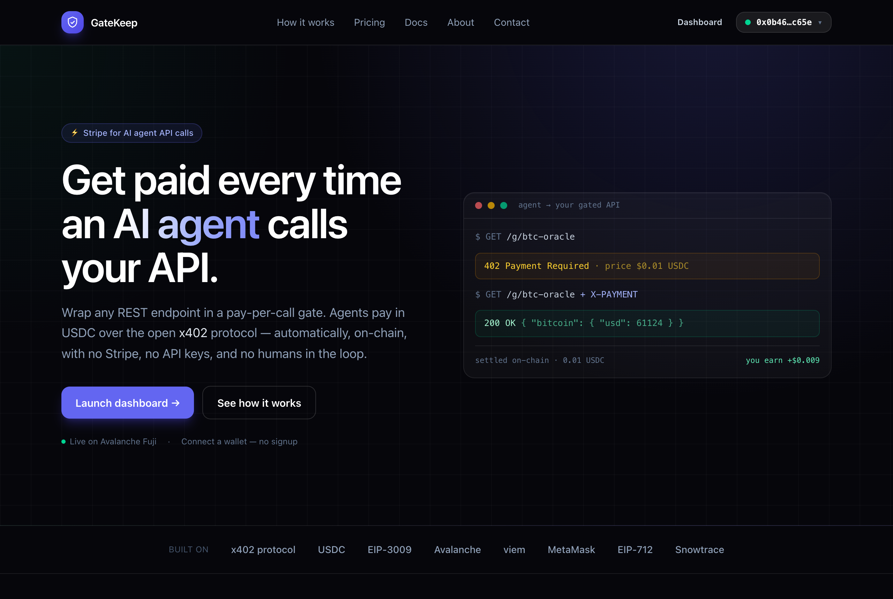
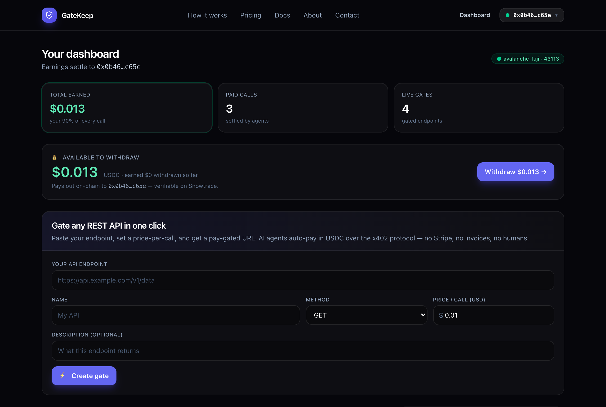
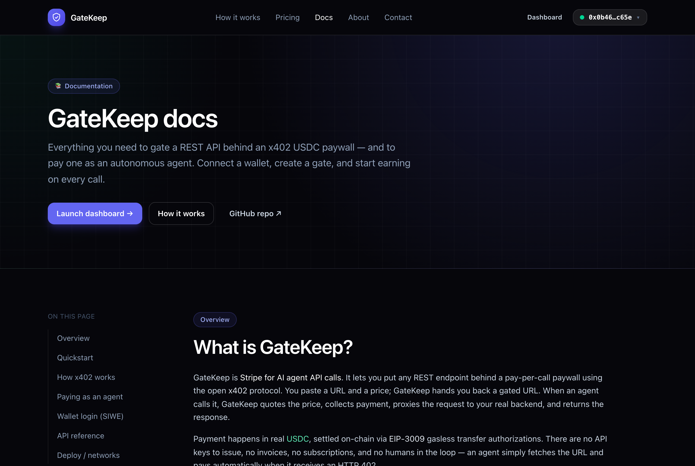

# 🛡️ GateKeep — Stripe for AI agent API calls

Wrap **any** REST API behind an [x402](https://x402.org) payment gate in one click.
Paste your endpoint, set a price-per-call, and get a new gated URL. AI agents that
hit it **auto-pay in USDC and get the response** — no Stripe, no invoices, no humans
in the loop. GateKeep takes a cut of every call.

> 402 Payment Required was the one HTTP status code the web never shipped. x402 finally
> turns it on — and agents, unlike humans, are happy to pay $0.001 to call an API.

---

## Demo

An AI agent paying a gated API from the terminal — `402 → sign → 200`, settled on-chain:


| Landing | Seller dashboard |
| --- | --- |
| [](docs/images/landing.png) | [](docs/images/dashboard.png) |

| Agent playground (live pay round-trip) | In-app docs |
| --- | --- |
| [](docs/images/playground.png) | [](docs/images/docs.png) |

More: [how it works](docs/images/how-it-works.png) · [pricing](docs/images/pricing.png).

---

## Why this exists

AI agents are becoming the dominant consumers of APIs, but the web has no native way
for them to pay per request. API owners are stuck with API keys, dashboards, and
monthly invoices that no agent can sign up for.

GateKeep is the missing payment layer:

| Without GateKeep | With GateKeep |
| --- | --- |
| Sign up, get an API key, add a credit card | Agent just calls the URL |
| Monthly plans, overage billing, invoices | Pay-per-call, settled in USDC, instantly |
| Humans in the loop | Fully autonomous |

You (the platform) earn a configurable cut of every single call — this is
**Stripe-for-agents**, and the take rate is your business model.

---

GateKeep is a full product: a marketing site (`/`, `/how-it-works`, `/docs`,
`/about`, `/contact`), a **wallet-based login**, and a seller **dashboard** (`/app`).

## Quickstart

```bash
npm install        # install deps (needs Node 18+)
npm run dev        # API on :4021, site on :5173
```

Open **http://localhost:5173**, then:

1. **Connect your wallet** (MetaMask) and sign in — your wallet is your account and
   your payout address. Signing is free and gasless (Sign-In with Ethereum).
2. In the **dashboard** (`/app`), **paste an endpoint** (e.g. `https://api.github.com/zen`),
   set a price, click **Create gate** — or hit **Load examples**.
3. Copy your gated URL (`http://localhost:4021/g/<id>`).
4. Click **▶ Run agent** to watch an AI agent discover the 402, sign a USDC payment,
   and unlock the response — live, step by step. You earn 90% of every call.
5. Hit **Withdraw** to pay your earned USDC on-chain to your wallet — a real
   transfer you can verify on Snowtrace.

### Test the agent without the UI

Copy a gated URL from the dashboard, then pay it from the terminal with the
bundled agent (the GIF above). This is the easiest way to confirm an agent can
pay your gate end-to-end:

```bash
# mock mode (offline):
npm run agent  -- http://localhost:4021/g/<id>

# Avalanche Fuji (real on-chain USDC settlement):
npm run fuji:agent -- http://localhost:4021/g/<id>

# use the official x402-fetch client instead of the hand-rolled signer:
npm run fuji:agent -- http://localhost:4021/g/<id> --lib
```

You'll see the `402 → sign EIP-3009 → 200` round-trip, the settlement tx hash,
and the upstream response. It uses the agent wallet from your env
(`AGENT_PRIVATE_KEY`), which must hold USDC in chain mode.

You can also just `curl` the gate to see the raw 402, or point **any** standard
x402 client at the URL — see [Integrating as an agent developer](#integrating-as-an-agent-developer).

> **Zero setup.** Out of the box GateKeep runs in **mock mode**: it signs *real*
> EIP-712 / EIP-3009 payment authorizations and verifies the signatures
> cryptographically, but *simulates* on-chain settlement — so the entire flow works
> offline with no wallet and no funds.

### Run it with REAL on-chain settlement (Avalanche Fuji)

To watch real USDC actually move on a blockchain, run GateKeep in `chain` mode
against the **Avalanche Fuji** testnet. Three commands:

```bash
npm run fuji:setup     # generates wallets → .env.fuji, prints the facilitator
                       # address + the faucet link
# → fund that facilitator address with test AVAX: https://faucet.avax.network
npm run fuji:deploy    # deploys MockUSDC to Fuji + mints USDC to the agent
npm run fuji:start     # runs GateKeep against Fuji → http://localhost:4021
```

Open the dashboard, click **Run agent**, and every payment is a real
`transferWithAuthorization` transaction — the agent's USDC balance drops, the
platform's rises, and you get a tx hash you can open on
[Snowtrace testnet](https://testnet.snowtrace.io). Full guide (incl. real Circle
USDC + mainnet): **[docs/DEPLOY.md](docs/DEPLOY.md)**.

**📚 Docs:** [Architecture & how x402 works](docs/ARCHITECTURE.md) ·
[Deploy to Avalanche](docs/DEPLOY.md)

---

## How it works

```
  AI agent                  GateKeep  /g/:id              Your upstream API
  ────────                  ──────────────────            ─────────────────
     │  GET /g/:id                  │                              │
     │ ───────────────────────────►│                              │
     │  402 Payment Required        │   (no X-PAYMENT header)      │
     │ ◄───────────────────────────│   { accepts: [requirements]} │
     │                              │                              │
     │  sign EIP-3009 USDC auth     │                              │
     │  (gasless, off-chain)        │                              │
     │                              │                              │
     │  GET /g/:id  +  X-PAYMENT    │                              │
     │ ───────────────────────────►│  verify signature            │
     │                              │ ──── proxy request ────────► │
     │                              │ ◄─── 200 + body ──────────── │
     │                              │  settle USDC (facilitator)   │
     │  200 OK + X-PAYMENT-RESPONSE │  split revenue: you + seller │
     │ ◄───────────────────────────│                              │
```

The protocol is the real [x402 spec](https://github.com/coinbase/x402): an
`exact`-scheme USDC payment, signed as an EIP-3009 `transferWithAuthorization` over
EIP-712 typed data, carried in a base64 `X-PAYMENT` header, verified and settled by a
facilitator. GateKeep speaks it faithfully so any standard x402 client
(`x402-fetch`, `x402-axios`, CDP AgentKit, …) can pay your gates unmodified.

---

## Architecture

```
contracts/
  MockUSDC.sol         minimal EIP-3009 USDC (real transferWithAuthorization)
scripts/
  deploy.ts            deploy MockUSDC + mint test USDC to the agent
  setup-fuji.ts        generate wallets + wire Avalanche Fuji (.env.fuji)
src/
  server.ts            Express app: gateway + API + auth + facilitator + SPA
  config.ts            env / mode / fee / wallet / chain / jwt config
  auth.ts              Sign-In with Ethereum: nonce, signature verify, JWT session
  store.ts             JSON-file persistence (owner-scoped endpoints + ledger)
  revenue.ts           seller-earnings / platform-fee math
  routes/
    gateway.ts         the /g/:id dynamic x402 proxy — the core (public)
    auth.ts            /api/auth/* — nonce, verify, me, logout (SIWE)
    api.ts             owner-scoped CRUD, stats, the agent-playground simulator
    facilitator.ts     GateKeep's own x402-compatible facilitator endpoints
  net/ssrf.ts          blocks gates pointed at private / metadata addresses
  x402/
    protocol.ts        build PaymentRequirements, encode/decode X-PAYMENT, EIP-712 domain
    signer.ts          agent-side: sign an EIP-3009 USDC authorization
    facilitator.ts     verify + settle — dispatches to mock or chain
    chain.ts           on-chain facilitator (viem): balance/nonce checks + settle tx
  agent/demo-agent.ts  standalone "AI agent" CLI that pays a gate
web/                   Vite + React + Tailwind product site
  src/lib/             wallet (MetaMask), auth (SIWE), typed API client
  src/pages/           Landing, HowItWorks, About, Contact, Docs, Dashboard
  src/components/      Navbar, Footer, WalletButton, design-system + dashboard UI
```

**Dynamic pricing.** Unlike the stock `x402-express` middleware (which gates a static
route map), GateKeep builds `PaymentRequirements` per-request from the endpoint the
user registered — so every gated URL has its own price, looked up at call time.

Full design walkthrough — including what x402 is and how settlement works — is in
[docs/ARCHITECTURE.md](docs/ARCHITECTURE.md).

---

## Settlement modes

One switch, `X402_MODE`, decides **how** a payment settles. Everything else — the
protocol, signing, the wire format — is identical.

| | `mock` (default) | `chain` |
| --- | --- | --- |
| EIP-712 signing | ✅ real | ✅ real |
| Signature verification | ✅ real (recovers signer) | ✅ real |
| On-chain settlement | simulated (deterministic tx hash) | ✅ real USDC transfer + tx hash |
| Replay protection | in-memory nonce set | the token's on-chain `authorizationState` |
| Needs an RPC / funded wallet | ❌ no | ✅ yes |
| Runs offline | ✅ yes | ❌ needs a chain |
| Use it for | demos, dev, CI | **Avalanche Fuji / Base / any EVM in prod** |

`chain` mode is RPC-agnostic — the same code settles against Avalanche Fuji,
Avalanche mainnet, Base, or any EVM chain with an EIP-3009 USDC. Going live is a
config change, not a code change — see the Fuji quickstart above and the full
walk-through (incl. real Circle USDC + mainnet) in **[docs/DEPLOY.md](docs/DEPLOY.md)**.
All the knobs are in [`.env.example`](.env.example) (mock) and
[`.env.fuji.example`](.env.fuji.example) (chain / Fuji).

---

## Integrating as an agent developer

Any x402 client works. With the official `x402-fetch`:

```ts
import { wrapFetchWithPayment } from 'x402-fetch';
import { createSigner } from 'x402/types';

const signer = await createSigner('base-sepolia', process.env.AGENT_KEY);
const fetchWithPay = wrapFetchWithPayment(fetch, signer);

// Just fetch — payment happens automatically on 402.
const res = await fetchWithPay('http://localhost:4021/g/<id>');
console.log(await res.json());
```

---

## HTTP API

| Method | Path | Purpose |
| --- | --- | --- |
| `ANY` | `/g/:id` | The gated proxy. 402 without payment, proxies upstream with it. **Public.** |
| `GET` | `/api/config` | Public runtime config (mode, network, chain id, fee). |
| `POST` | `/api/auth/nonce` | Get a Sign-In-with-Ethereum message to sign. |
| `POST` | `/api/auth/verify` | Verify the signature → start a session (cookie). |
| `GET` | `/api/auth/me` · `POST /logout` | Session identity / sign out. |
| `GET` | `/api/endpoints` 🔒 | Your gated endpoints + per-endpoint stats. |
| `POST` | `/api/endpoints` 🔒 | Create a gate `{ name, upstreamUrl, method, priceUsd }`. |
| `PATCH` · `DELETE` | `/api/endpoints/:id` 🔒 | Update / remove a gate you own. |
| `POST` | `/api/examples` 🔒 | Add the example endpoints to your account. |
| `POST` | `/api/endpoints/:id/simulate` 🔒 | Run the full pay round-trip, return a transcript. |
| `GET` | `/api/stats` · `/api/calls` 🔒 | Your earnings, volume, and call ledger. |
| `POST` | `/api/withdraw` 🔒 | Pay your earned USDC on-chain to your wallet. |
| `POST` | `/facilitator/verify` · `/settle` | GateKeep's own x402 facilitator surface. |

🔒 = requires a signed-in wallet (session cookie).

### Wallet login (Sign-In with Ethereum)

There are no passwords. The dashboard asks your wallet for a one-time message, you
sign it (free, gasless), and the server verifies the signature and starts a session.
Your wallet address **is** your account — and your USDC payout address. Each seller
sees only their own gates, calls, and earnings.

---

## Scripts

| Command | What it does |
| --- | --- |
| `npm run dev` | API (`:4021`) + dashboard (`:5173`) with hot reload (mock mode) |
| `npm run build` | Build the dashboard to `web/dist` |
| `npm start` | Production: serve API + built dashboard on `:4021` |
| `npm run agent` | Standalone agent that pays a gate |
| `npm run fuji:setup` | Generate wallets + wire **Avalanche Fuji** testnet (`.env.fuji`) |
| `npm run fuji:deploy` | Deploy MockUSDC to Fuji + mint to the agent |
| `npm run fuji:start` | Run GateKeep against Avalanche Fuji |
| `npm run fuji:agent` | Pay a Fuji gate from the terminal |
| `npm run contracts:build` | Recompile `MockUSDC.sol` → `contracts/out/` |

### Troubleshooting

If `npm run dev`/`build` fails with *"Cannot find native binding"* (a known npm
[optional-dependency bug](https://github.com/npm/cli/issues/4828)), reinstall:

```bash
rm -rf node_modules package-lock.json && npm install
```

---

Built in a day with the [`x402`](https://www.npmjs.com/package/x402) package. Not affiliated with Coinbase or Stripe.
