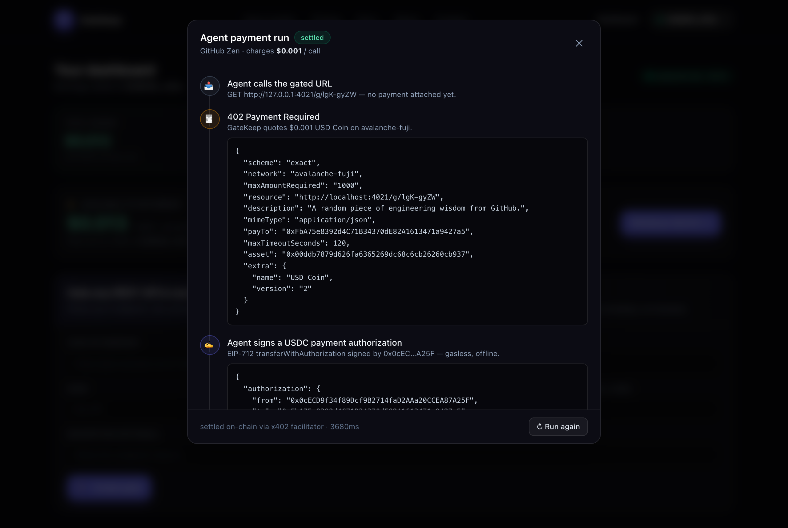
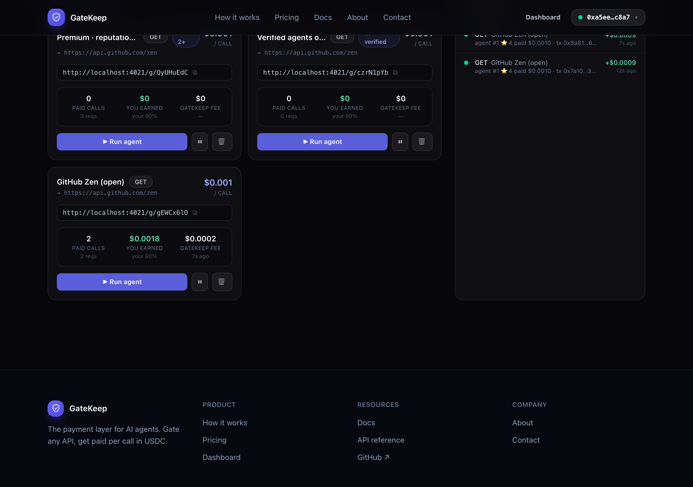
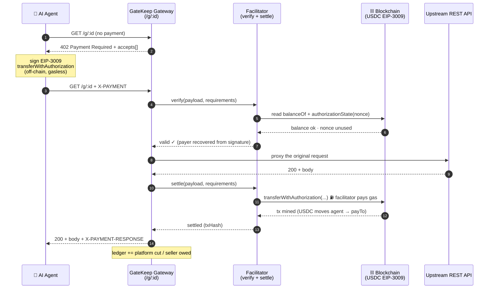
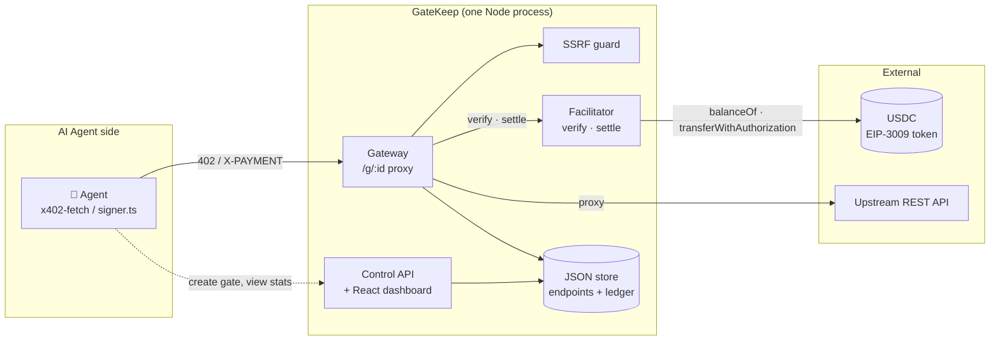
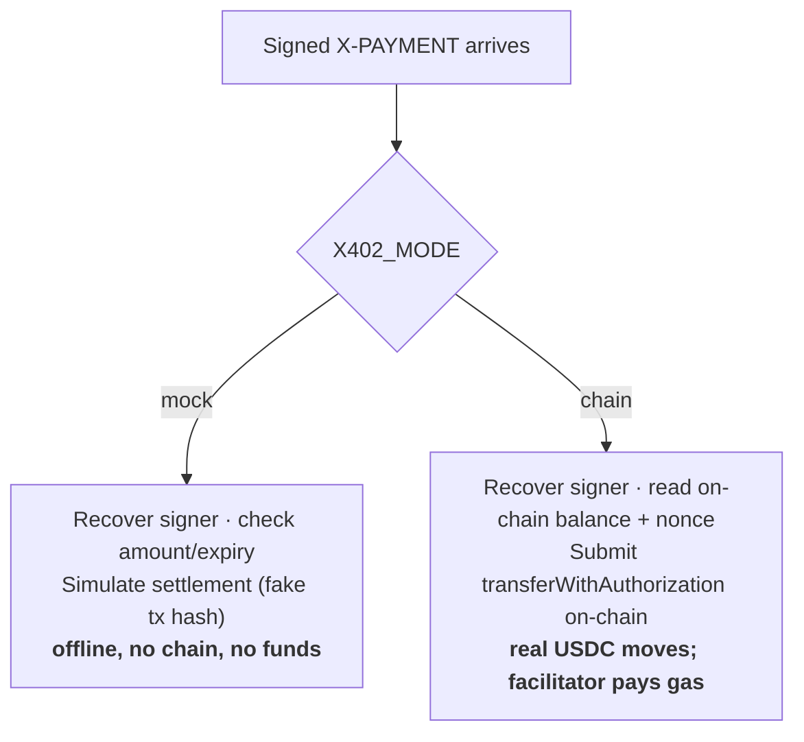
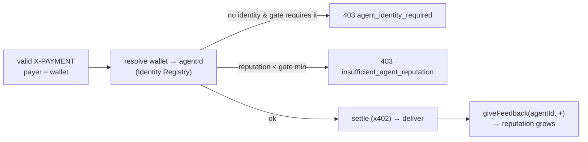

# 🛡️ GateKeep — Stripe for AI agent API calls

Wrap **any** REST API behind an [x402](https://x402.org) payment gate in one click.
Paste your endpoint, set a price-per-call, and get a new gated URL. AI agents that
hit it **auto-pay in USDC and get the response** — no Stripe, no invoices, no humans
in the loop. GateKeep takes a cut of every call.

It combines the two primitives of agentic payments: **x402** for the payment rail,
and **[ERC-8004](https://eips.ethereum.org/EIPS/eip-8004)** (Trustless Agents) for
on-chain identity + reputation — so a gate can require a *verified* agent and tier
access by *reputation*, and every paid call writes feedback that builds that agent's
on-chain track record. Payments that are also identity- and reputation-aware.

> 402 Payment Required was the one HTTP status code the web never shipped. x402 finally
> turns it on — and agents, unlike humans, are happy to pay $0.001 to call an API.
>
> Built for the **Avalanche "Agentic Payments" Speedrun** — live on Fuji, x402 + ERC-8004.

This is the **single, complete document** for GateKeep — overview, architecture,
deploy guide, and a presenter's cheat sheet, all in one place.

---

## Contents

- [Demo](#demo)
- [Pitch deck](#pitch-deck)
- [Deployed on Avalanche Fuji](#deployed-on-avalanche-fuji)
- [Why this exists](#why-this-exists)
- [What is x402](#what-is-x402)
- [Quickstart](#quickstart)
- [How it works](#how-it-works)
- [Architecture](#architecture)
- [Settlement modes](#settlement-modes)
- [Identity and reputation (ERC-8004)](#identity-and-reputation-erc-8004)
- [MockUSDC vs real USDC](#mockusdc-vs-real-usdc)
- [Revenue model](#revenue-model)
- [Security](#security)
- [Deploying to Avalanche](#deploying-to-avalanche)
- [Integrating as an agent developer](#integrating-as-an-agent-developer)
- [HTTP API](#http-api)
- [Scripts and troubleshooting](#scripts-and-troubleshooting)
- [Glossary](#glossary)
- [Presenting GateKeep (cheat sheet)](#presenting-gatekeep-cheat-sheet)

---

## Demo

An AI agent paying a gated API from the terminal — `402 → sign → 200`, settled on-chain:


| Landing | Seller dashboard |
| --- | --- |
| [](docs/images/landing.png) | [](docs/images/dashboard.png) |

| Agent playground (live pay round-trip) | Identity- & reputation-aware gates |
| --- | --- |
| [](docs/images/playground.png) | [](docs/images/erc8004.png) |

More: [in-app docs](docs/images/docs.png) · [how it works](docs/images/how-it-works.png) · [pricing](docs/images/pricing.png).

---

## Pitch deck

A 13-slide investor pitch (the story, the market, the moat, the ask):
**[docs/GateKeep-Investor-Deck.pptx](docs/GateKeep-Investor-Deck.pptx)**.

Regenerate it from source with `python scripts/build_pitch_deck.py` (needs
[`python-pptx`](https://python-pptx.readthedocs.io)).

---

## Deployed on Avalanche Fuji

GateKeep runs live on the Avalanche **Fuji testnet** (chain id `43113`). Three contracts
are deployed and every payment / withdrawal / attestation is a real on-chain transaction,
verifiable on [Snowtrace](https://testnet.snowtrace.io).

### Smart contracts

| Contract | Address | What it does |
| --- | --- | --- |
| **MockUSDC** (EIP-3009) | [`0x00ddb787…60cb937`](https://testnet.snowtrace.io/address/0x00ddb7879d626fa6365269dc68c6cb26260cb937) | The USDC test token every payment settles in. Implements `transferWithAuthorization` — gasless, signature-based transfers — the **exact mechanism real Circle USDC uses**, so swapping in real USDC needs no code change. |
| **IdentityRegistry** (ERC-8004) | [`0xde9786b2…7EA7f73`](https://testnet.snowtrace.io/address/0xde9786b26603a54e35749922495d34fca7ea7f73) | ERC-721 of agent identities. An agent calls `register()` → gets an `agentId` and binds its payment wallet, so a gate can resolve a paying wallet to a known, verifiable agent. |
| **ReputationRegistry** (ERC-8004) | [`0x34c2d005…05965421`](https://testnet.snowtrace.io/address/0x34c2d005e7a3fc907432f5446aaf077f05965421) | Stores `giveFeedback` attestations about each agent (`getSummary` reads count/score). GateKeep writes a positive attestation after every successful paid call → the agent's reputation grows. |

Source: [`contracts/MockUSDC.sol`](contracts/MockUSDC.sol) and [`contracts/ERC8004.sol`](contracts/ERC8004.sol)
(Identity + Reputation in one file). Compiled with `solc`, deployed with `viem`
(`scripts/deploy.ts`, `scripts/deploy-erc8004.ts`).

### Key accounts (testnet wallets)

Auto-generated test wallets — their private keys live in the gitignored `.env.fuji`;
the addresses are public and viewable on Snowtrace. These are **EOAs (wallets), not contracts**:

| Role | Address | What it does |
| --- | --- | --- |
| **Facilitator** | `0x8c32F8…319677` | Submits x402 settlement txs + deploys contracts; pays the AVAX gas. |
| **Platform treasury** | `0xFbA75e…9427a5` | Receives the gross USDC from every call; signs seller withdrawal payouts. |
| **Demo agent** | `0x0cECD9…87A25F` | The example paying agent (registered as **agentId 1**); holds USDC and pays gates. |

> Production: swap MockUSDC for Circle's real USDC (no deploy needed) and keep your own
> ERC-8004 registries — only the env addresses change. See [Deploying to Avalanche](#deploying-to-avalanche).

---

## Why this exists

AI agents are becoming the dominant consumers of APIs, but the web has no native way
for them to pay per request. API owners are stuck with API keys, dashboards, and
monthly invoices that no agent can sign up for.

GateKeep is the missing payment layer:

| Without GateKeep | With GateKeep |
| --- | --- |
| Sign up, get an API key, add a credit card | Agent just calls the URL |
| Monthly plans, overage billing, invoices | Pay-per-call, settled in USDC, instantly |
| Humans in the loop | Fully autonomous |

You (the platform) earn a configurable cut of every single call — this is
**Stripe-for-agents**, and the take rate is your business model.

---

## What is x402

**x402** is an open protocol (introduced by Coinbase) that finally gives HTTP
`402 Payment Required` — reserved since 1997, never standardized — a concrete,
machine-payable meaning:

> When a client requests a paid resource without paying, the server replies **`402`**
> with a machine-readable description of *how much* to pay and *where*. The client
> pays by **signing a stablecoin (USDC) transfer**, attaches the signature to a retry,
> and the server fulfils it.

The payment is a **gasless, signature-based USDC transfer**
([EIP-3009](https://eips.ethereum.org/EIPS/eip-3009) `transferWithAuthorization`):

- The agent **signs** an authorization off-chain — it costs nothing and touches no chain.
- A **facilitator** submits that signature on-chain and **pays the gas**. The agent
  never needs native gas tokens — only USDC.

So an agent with a USDC-holding wallet can pay any x402 endpoint with **zero accounts,
zero API keys, zero gas, and zero human involvement.**

### The wire protocol, concretely

**Step 1 — unpaid request gets a 402:**

```http
GET /g/abc123 HTTP/1.1
```
```http
HTTP/1.1 402 Payment Required
Content-Type: application/json

{
  "x402Version": 1,
  "error": "X-PAYMENT header is required",
  "accepts": [{
    "scheme": "exact",
    "network": "avalanche-fuji",
    "maxAmountRequired": "10000",            // 0.01 USDC (6 decimals)
    "resource": "https://api.example.com/g/abc123",
    "payTo": "0xFbA75e…9427a5",              // where the money goes
    "asset": "0x00ddb787…60cb937",           // the USDC contract
    "maxTimeoutSeconds": 120,
    "extra": { "name": "USD Coin", "version": "2" }   // EIP-712 domain
  }]
}
```

**Step 2 — the agent signs an EIP-3009 authorization** over EIP-712 typed data:

```js
TransferWithAuthorization {
  from:        agentAddress,
  to:          payTo,
  value:       10000,                 // atomic USDC
  validAfter:  0,
  validBefore: now + maxTimeoutSeconds,
  nonce:       random 32 bytes
}
```

…and base64-encodes the `{ signature, authorization }` into an **`X-PAYMENT`** header.

**Step 3 — retry with payment → resource is delivered:**

```http
GET /g/abc123 HTTP/1.1
X-PAYMENT: eyJ4NDAyVmVyc2lvbiI6MSwic2NoZW1lIjoiZXhhY3QiLCJ…

HTTP/1.1 200 OK
X-PAYMENT-RESPONSE: eyJzdWNjZXNzIjp0cnVlLCJ0cmFuc2FjdGlvbiI6IjB4…   // tx hash
Content-Type: application/json

{ "the": "actual upstream response" }
```

GateKeep speaks this faithfully, so **any** standard x402 client (`x402-fetch`,
`x402-axios`, Coinbase AgentKit, …) can pay a GateKeep URL with no special integration.

---

## Quickstart

GateKeep is a full product: a marketing site (`/`, `/how-it-works`, `/docs`,
`/about`, `/contact`), a **wallet-based login**, and a seller **dashboard** (`/app`).

```bash
npm install        # install deps (needs Node 18+)
npm run dev        # API on :4021, site on :5173
```

Open **http://localhost:5173**, then:

1. **Connect your wallet** (MetaMask) and sign in — your wallet is your account and
   your payout address. Signing is free and gasless (Sign-In with Ethereum).
2. In the **dashboard** (`/app`), **paste an endpoint** (e.g. `https://api.github.com/zen`),
   set a price, click **Create gate** — or hit **Load examples**.
3. Copy your gated URL (`http://localhost:4021/g/<id>`).
4. Click **▶ Run agent** to watch an AI agent discover the 402, sign a USDC payment,
   and unlock the response — live, step by step. You earn 90% of every call.
5. Hit **Withdraw** to pay your earned USDC on-chain to your wallet — a real
   transfer you can verify on Snowtrace.

> **Zero setup.** Out of the box GateKeep runs in **mock mode**: it signs *real*
> EIP-712 / EIP-3009 payment authorizations and verifies the signatures
> cryptographically, but *simulates* on-chain settlement — so the entire flow works
> offline with no wallet and no funds.

### Test the agent without the UI

Copy a gated URL from the dashboard, then pay it from the terminal with the bundled
agent (the GIF above) — the easiest way to confirm an agent can pay your gate:

```bash
# mock mode (offline):
npm run agent  -- http://localhost:4021/g/<id>

# Avalanche Fuji (real on-chain USDC settlement):
npm run fuji:agent -- http://localhost:4021/g/<id>

# use the official x402-fetch client instead of the hand-rolled signer:
npm run fuji:agent -- http://localhost:4021/g/<id> --lib
```

You'll see the `402 → sign EIP-3009 → 200` round-trip, the settlement tx hash, and the
upstream response. It uses the agent wallet from your env (`AGENT_PRIVATE_KEY`), which
must hold USDC in chain mode. You can also just `curl` the gate to see the raw 402.

### Run it with REAL on-chain settlement (Avalanche Fuji)

```bash
npm run fuji:setup     # generates wallets → .env.fuji, prints the facilitator
                       # address + the faucet link
# → fund that facilitator address with test AVAX: https://faucet.avax.network
npm run fuji:deploy    # deploys MockUSDC to Fuji + mints USDC to the agent
npm run fuji:erc8004   # (optional) deploy ERC-8004 registries + register the demo agent
npm run fuji:start     # runs GateKeep against Fuji → http://localhost:4021
```

Open the dashboard, click **Run agent**, and every payment is a real
`transferWithAuthorization` transaction with a tx hash on
[Snowtrace](https://testnet.snowtrace.io). Full walk-through: [Deploying to Avalanche](#deploying-to-avalanche).

---

## How it works



Two rules make this safe and fair, both enforced in [`src/routes/gateway.ts`](src/routes/gateway.ts):

- **Verify before serving, settle after.** The cheap off-chain checks (signature,
  recipient, amount, expiry, balance, nonce) gate access. On-chain settlement happens
  once the upstream has produced a successful response.
- **No money for nothing.** If the upstream returns a non-2xx, the agent is **not
  charged**. If settlement fails, the resource is **withheld** and a fresh 402 is
  returned. You can never be billed for a response you didn't get.

The dashboard's **agent playground** runs this exact round-trip live and shows every
step — the 402 quote, the signed authorization, the on-chain settlement, the response:

[](docs/images/playground.png)

---

## Architecture



| Module | File | Responsibility |
| --- | --- | --- |
| **Gateway** | [`routes/gateway.ts`](src/routes/gateway.ts) | The `/g/:id` proxy — the 402 dance, SSRF-guarded upstream proxy, charge-on-2xx, settlement gating, ERC-8004 policy |
| **Protocol** | [`x402/protocol.ts`](src/x402/protocol.ts) | Builds `PaymentRequirements`, encodes/decodes `X-PAYMENT`, resolves the asset + EIP-712 domain |
| **Signer** | [`x402/signer.ts`](src/x402/signer.ts) | Agent side — signs the EIP-3009 authorization |
| **Facilitator** | [`x402/facilitator.ts`](src/x402/facilitator.ts) · [`x402/chain.ts`](src/x402/chain.ts) | `verify` + `settle`, dispatched to mock or on-chain |
| **ERC-8004** | [`erc8004/registry.ts`](src/erc8004/registry.ts) | Resolve wallet → agentId, read reputation, write feedback |
| **SSRF guard** | [`net/ssrf.ts`](src/net/ssrf.ts) | Blocks gates pointed at loopback / link-local / private IPs |
| **Auth** | [`auth.ts`](src/auth.ts) · [`routes/auth.ts`](src/routes/auth.ts) | Sign-In with Ethereum: nonce, signature verify, JWT session |
| **Control API** | [`routes/api.ts`](src/routes/api.ts) | Owner-scoped registry CRUD, stats, the live agent-playground simulator |
| **Store** | [`store.ts`](src/store.ts) | Atomic JSON persistence of endpoints + ledger + withdrawals |
| **Dashboard** | [`web/`](web/) | React + Tailwind product site |

### File tree

```
contracts/
  MockUSDC.sol         minimal EIP-3009 USDC (real transferWithAuthorization)
  ERC8004.sol          ERC-8004 Identity (ERC-721) + Reputation registries
scripts/
  deploy.ts            deploy MockUSDC + mint test USDC to the agent
  deploy-erc8004.ts    deploy ERC-8004 registries + register the demo agent
  setup-fuji.ts        generate wallets + wire Avalanche Fuji (.env.fuji)
src/
  server.ts            Express app: gateway + API + auth + facilitator + SPA
  config.ts            env / mode / fee / wallet / chain / jwt config
  auth.ts              Sign-In with Ethereum: nonce, signature verify, JWT session
  store.ts             JSON-file persistence (owner-scoped endpoints + ledger)
  revenue.ts           seller-earnings / platform-fee math
  routes/
    gateway.ts         the /g/:id dynamic x402 proxy — the core (public)
    auth.ts            /api/auth/* — nonce, verify, me, logout (SIWE)
    api.ts             owner-scoped CRUD, stats, agent-playground, withdraw
    facilitator.ts     GateKeep's own x402-compatible facilitator endpoints
  net/ssrf.ts          blocks gates pointed at private / metadata addresses
  x402/
    protocol.ts        build PaymentRequirements, encode/decode X-PAYMENT, EIP-712 domain
    signer.ts          agent-side: sign an EIP-3009 USDC authorization
    facilitator.ts     verify + settle — dispatches to mock or chain
    chain.ts           on-chain facilitator (viem): balance/nonce checks + settle + payout
  erc8004/registry.ts  ERC-8004: resolve identity, read reputation, write feedback
  agent/demo-agent.ts  standalone "AI agent" CLI that pays a gate
web/                   Vite + React + Tailwind product site
  src/lib/             wallet (MetaMask), auth (SIWE), typed API client
  src/pages/           Landing, HowItWorks, About, Contact, Docs, Dashboard
  src/components/      Navbar, Footer, WalletButton, design-system + dashboard UI
```

**Dynamic pricing.** Unlike the stock `x402-express` middleware (which gates a static
route map), GateKeep builds `PaymentRequirements` per-request from the endpoint the
user registered — so every gated URL has its own price, looked up at call time.

---

## Settlement modes

One switch, `X402_MODE`, decides **how** a payment settles. Everything else — the
protocol, signing, the wire format — is identical.



| | `mock` (default) | `chain` |
| --- | --- | --- |
| EIP-712 signing | ✅ real | ✅ real |
| Signature verification | ✅ real (recovers signer) | ✅ real |
| On-chain settlement | simulated (deterministic tx hash) | ✅ real USDC transfer + tx hash |
| Replay protection | in-memory nonce set | the token's on-chain `authorizationState` |
| Needs an RPC / funded wallet | ❌ no | ✅ yes |
| Runs offline | ✅ yes | ❌ needs a chain |
| Use it for | demos, dev, CI | **Avalanche Fuji / mainnet / any EVM** |

`chain` mode is RPC-agnostic — the same code settles against Avalanche Fuji, Avalanche
mainnet, Base, or any EVM chain with an EIP-3009 USDC. Going live is a config change,
not a code change (see [Deploying to Avalanche](#deploying-to-avalanche)). All the knobs
are in [`.env.example`](.env.example) (mock) and [`.env.fuji.example`](.env.fuji.example) (chain).

---

## Identity and reputation (ERC-8004)

x402 settles the money; **ERC-8004** ("Trustless Agents") answers *who is paying* and
*whether to trust them*. GateKeep deploys ERC-8004 **Identity** + **Reputation**
registries on Fuji and makes every gate optionally **identity- and reputation-aware**.

- **Identity Registry** — an ERC-721 of agent identities. `register(agentURI)` mints an
  `agentId`; `setAgentWallet(agentId, wallet)` binds the wallet the agent pays from
  (plus a `wallet → agentId` reverse index so a gateway can resolve a payer).
- **Reputation Registry** — `giveFeedback(agentId, value, …)` records attestations;
  `getSummary(agentId)` returns the count + average. GateKeep uses the **count** of
  positive attestations as the reputation signal.

Per-gate policy (`requireIdentity`, `minReputation`). In the gateway, *after* the x402
payment verifies and *before* settlement:



- **Verified agents only** — a gate can require a registered identity; unregistered wallets get a `403`.
- **Reputation tiers** — require a minimum reputation; low-rep agents are turned away until they earn trust.
- **Feedback loop** — each paid call writes on-chain feedback → the agent's reputation grows, unlocking higher tiers.

[](docs/images/erc8004.png)

```bash
npm run fuji:erc8004    # deploy the registries + register the demo agent
```

Verified end-to-end on Fuji: an unregistered (but funded) agent → identity-gated gate
returns `403 agent_identity_required`; a registered agent is served and its reputation
climbs `0 → 3` across paid calls, unlocking a `reputation 3+` gate. Integration:
[`src/erc8004/registry.ts`](src/erc8004/registry.ts) + the gate policy in [`src/routes/gateway.ts`](src/routes/gateway.ts).

> Simplifications for the sprint: `setAgentWallet` is owner-gated (no EIP-712
> delegation), the Validation Registry is omitted, and feedback is written by the
> platform wallet attesting successful payments. The interfaces match ERC-8004 so the
> registries are drop-in compatible.

---

## MockUSDC vs real USDC

[`contracts/MockUSDC.sol`](contracts/MockUSDC.sol) is a ~120-line ERC-20 whose only job
is to be *protocol-identical* to Circle's USDC for the parts x402 touches:

- Same EIP-712 domain shape (`name`, `version`, `chainId`, `verifyingContract`).
- Same `TransferWithAuthorization` typehash and struct.
- Same `transferWithAuthorization(...)` and `authorizationState(...)` interface.

The only addition is an open `mint()` faucet so you can fund test agents freely. Swap its
address for real USDC and **nothing in GateKeep changes** — the facilitator calls the same
method on the same interface.

---

## Revenue model

```
   Agent pays  $0.010
              ├─ $0.001  platform fee   →  you (the GateKeep operator)
              └─ $0.009  seller earnings →  the API owner
```

Every settled call is split and recorded in the ledger ([`revenue.ts`](src/revenue.ts), [`store.ts`](src/store.ts)):

- On-chain, the agent pays the full price to `payTo` (the platform wallet), which
  accumulates the gross USDC from every settlement.
- The ledger records `platformFee = price × feeRate` as **your** revenue and the
  remainder as the **seller's earnings**.
- The seller **withdraws** their accrued earnings on-chain, self-serve, from the
  dashboard: `POST /api/withdraw` calls `payoutUsdc()` ([`x402/chain.ts`](src/x402/chain.ts)),
  which transfers their share from the platform wallet to their login wallet
  (`available = earned − already withdrawn`). The platform keeps its fee.

This mirrors Stripe — the platform collects gross, holds it, and pays out the seller's
share — except every leg is a verifiable on-chain transfer. Withdrawals require `chain`
mode and a funded platform wallet (`PLATFORM_PRIVATE_KEY` + a little AVAX for gas). The
take rate is set by `PLATFORM_FEE_BPS` (basis points; `1000` = 10%).

---

## Security

- **SSRF.** Because operators register arbitrary upstream URLs, every proxied request is
  checked against loopback / link-local (incl. `169.254.169.254` cloud metadata) / private
  ranges, and redirects are not auto-followed ([`net/ssrf.ts`](src/net/ssrf.ts)).
- **Replay.** EIP-3009 nonces are single-use — enforced on-chain by the token in `chain`
  mode, and by an in-memory set in `mock` mode.
- **No credential leakage.** `cookie`, `authorization`, and the `x-payment` header are
  stripped before proxying to the (operator-supplied) upstream.
- **Hot wallets.** In `chain` mode the facilitator + platform wallets sign continuously —
  treat their keys like hot wallets (secret manager, balance alerts).

---

## Deploying to Avalanche

GateKeep's `chain` mode is **RPC-agnostic** — the same code settles against Avalanche
Fuji, Avalanche mainnet, or any EVM chain with an EIP-3009 USDC. Going live is a **config
change, not a code change**. (The same steps work for Base, Polygon, etc.)

### Quickest path — Fuji in a few commands

```bash
npm run fuji:setup     # generate wallets → .env.fuji (gitignored), print the
                       # facilitator address + the faucet link
# → fund the printed facilitator address at https://faucet.avax.network
npm run fuji:deploy    # deploy MockUSDC, mint USDC to the agent, write USDC_ADDRESS back
npm run fuji:erc8004   # (optional) deploy ERC-8004 registries + register the demo agent
npm run fuji:start     # run GateKeep against Fuji on http://localhost:4021
```

The only manual step is funding one wallet with test AVAX (faucets need a captcha).

### The three wallets

| Role | Env | Needs | What it does |
| --- | --- | --- | --- |
| **Facilitator** | `FACILITATOR_PRIVATE_KEY` | native gas (AVAX) | submits settlement txs, pays gas |
| **Agent** | `AGENT_PRIVATE_KEY` | USDC | the demo payer (your real agents bring their own wallets) |
| **Platform** | `PLATFORM_WALLET` + `PLATFORM_PRIVATE_KEY` | gross USDC + a little AVAX | receives gross, signs seller withdrawals |

Two wallets spend gas: the **facilitator** on each settlement, and the **platform wallet**
on each seller **withdrawal**. Both need a small AVAX balance.

### Reference values

| | Fuji (testnet) | Mainnet (C-Chain) |
| --- | --- | --- |
| `CHAIN_ID` | `43113` | `43114` |
| `RPC_URL` | `https://api.avax-test.network/ext/bc/C/rpc` | `https://api.avax.network/ext/bc/C/rpc` |
| Explorer | https://testnet.snowtrace.io | https://snowtrace.io |
| AVAX faucet | https://faucet.avax.network | — (buy AVAX) |
| Native USDC | *(deploy MockUSDC, or use Circle's test USDC)* | `0xB97EF9Ef8734C71904D8002F8b6Bc66Dd9c48a6E` ⚠️ verify |

> ⚠️ **Always verify the USDC address** against Circle's official list
> (<https://developers.circle.com/stablecoins/usdc-contract-addresses>) before sending
> real money — third-party token addresses go stale.

### Path A — Fuji with MockUSDC (recommended demo)

`npm run fuji:setup` generates a facilitator + agent + platform wallet into `.env.fuji`
and prints the facilitator address; fund it with Fuji AVAX. The file looks like:

```bash
X402_MODE=chain
X402_NETWORK=avalanche-fuji
CHAIN_ID=43113
RPC_URL=https://api.avax-test.network/ext/bc/C/rpc

USDC_ADDRESS=                  # filled in automatically by fuji:deploy
USDC_NAME=USD Coin
USDC_VERSION=2
USDC_DECIMALS=6

FACILITATOR_PRIVATE_KEY=0x<funded facilitator key>
AGENT_PRIVATE_KEY=0x<agent key>
PLATFORM_WALLET=0x<treasury address>
PLATFORM_PRIVATE_KEY=0x<treasury key — signs seller withdrawals, needs AVAX>
PLATFORM_FEE_BPS=1000
# IDENTITY_REGISTRY / REPUTATION_REGISTRY — filled in by fuji:erc8004
```

Then `npm run fuji:deploy` deploys MockUSDC, mints 1,000 test USDC to the agent, and writes
`USDC_ADDRESS` back. `npm run fuji:start` serves the app. Click **Run agent** and verify the
tx on [Snowtrace testnet](https://testnet.snowtrace.io).

### Path B — Fuji or mainnet with real Circle USDC

For a production-grade setup, settle in real Circle USDC instead of MockUSDC. Get USDC into
the agent wallet (Circle's faucet <https://faucet.circle.com> on testnet, or bridge/buy on
mainnet), then point the config at the real token — **no deploy step**:

```bash
X402_MODE=chain
X402_NETWORK=avalanche            # or avalanche-fuji
CHAIN_ID=43114                    # 43113 for Fuji
RPC_URL=https://api.avax.network/ext/bc/C/rpc
USDC_ADDRESS=0xB97EF9Ef8734C71904D8002F8b6Bc66Dd9c48a6E   # ⚠️ verify on Circle's list
USDC_NAME=USD Coin
USDC_VERSION=2
USDC_DECIMALS=6
FACILITATOR_PRIVATE_KEY=0x<facilitator, funded with AVAX for gas>
PLATFORM_WALLET=0x<your USDC treasury address>
PLATFORM_PRIVATE_KEY=0x<treasury key — signs seller withdrawals, needs AVAX>
```

> Confirm `USDC_NAME` / `USDC_VERSION` / `CHAIN_ID` match the token's EIP-712 domain (Circle
> USDC is `"USD Coin"` / `"2"`); a mismatch makes every signature fail verification.

### Running it as a real service

- **Reverse proxy + TLS.** Put GateKeep behind nginx/Caddy with HTTPS and set
  `PUBLIC_BASE_URL=https://your-domain` so the `resource` field in 402s (and your gated URLs)
  are correct and reachable by agents.
- **Process manager.** Run under systemd / pm2 / a container — `npm start` serves the API +
  built dashboard on one port.
- **Persistence.** The default store is a JSON file in `DATA_DIR` (atomic writes,
  flush-on-exit). For real scale, swap [`store.ts`](src/store.ts) for Postgres — the
  interface is small and self-contained.
- **Keep both wallets funded + keyed from a secret manager.** If the facilitator runs out of
  AVAX, settlements fail (agents get a 402, not a free response — safe, but you stop earning).
  If the platform wallet runs out, withdrawals fail. Alert on both balances.

### Going to mainnet — checklist

- [ ] `USDC_ADDRESS` verified against Circle's official list
- [ ] `CHAIN_ID=43114` and a reliable mainnet `RPC_URL` (consider a paid RPC for uptime)
- [ ] Facilitator + platform keys in a secret manager, funded with AVAX, balance-alerted
- [ ] `PLATFORM_WALLET` is an address you control (a multisig holding seller balances should be hardened)
- [ ] `PUBLIC_BASE_URL` is your public HTTPS origin
- [ ] Withdrawals tested end-to-end (`/api/withdraw` → USDC lands in the seller's wallet)
- [ ] Load-tested; store swapped to a real DB if needed

---

## Integrating as an agent developer

Any x402 client works. With the official `x402-fetch`:

```ts
import { wrapFetchWithPayment } from 'x402-fetch';
import { createSigner } from 'x402/types';

const signer = await createSigner('avalanche-fuji', process.env.AGENT_KEY);
const fetchWithPay = wrapFetchWithPayment(fetch, signer);

// Just fetch — payment happens automatically on 402.
const res = await fetchWithPay('http://localhost:4021/g/<id>');
console.log(await res.json());
```

---

## HTTP API

| Method | Path | Purpose |
| --- | --- | --- |
| `ANY` | `/g/:id` | The gated proxy. 402 without payment, proxies upstream with it. **Public.** |
| `GET` | `/api/config` | Public runtime config (mode, network, chain id, fee, ERC-8004 registries). |
| `POST` | `/api/auth/nonce` | Get a Sign-In-with-Ethereum message to sign. |
| `POST` | `/api/auth/verify` | Verify the signature → start a session (cookie). |
| `GET` | `/api/auth/me` · `POST /logout` | Session identity / sign out. |
| `GET` | `/api/endpoints` 🔒 | Your gated endpoints + per-endpoint stats. |
| `POST` | `/api/endpoints` 🔒 | Create a gate (price, target, optional ERC-8004 identity/reputation policy). |
| `PATCH` · `DELETE` | `/api/endpoints/:id` 🔒 | Update / remove a gate you own. |
| `POST` | `/api/examples` 🔒 | Add the example endpoints to your account. |
| `POST` | `/api/endpoints/:id/simulate` 🔒 | Run the full pay round-trip, return a transcript. |
| `GET` | `/api/stats` · `/api/calls` 🔒 | Your earnings, volume, withdrawable balance, call ledger. |
| `POST` | `/api/withdraw` 🔒 | Pay your earned USDC on-chain to your wallet. |
| `POST` | `/facilitator/verify` · `/settle` | GateKeep's own x402 facilitator surface. |

🔒 = requires a signed-in wallet (session cookie).

**Wallet login (Sign-In with Ethereum).** There are no passwords. The dashboard asks your
wallet for a one-time message, you sign it (free, gasless), and the server verifies the
signature and starts a session. Your wallet address **is** your account — and your USDC
payout address. Each seller sees only their own gates, calls, and earnings.

---

## Scripts and troubleshooting

| Command | What it does |
| --- | --- |
| `npm run dev` | API (`:4021`) + dashboard (`:5173`) with hot reload (mock mode) |
| `npm run build` | Build the dashboard to `web/dist` |
| `npm start` | Production: serve API + built dashboard on `:4021` |
| `npm run agent -- <url>` | Standalone agent that pays a gate |
| `npm run fuji:setup` | Generate wallets + wire **Avalanche Fuji** testnet (`.env.fuji`) |
| `npm run fuji:deploy` | Deploy MockUSDC to Fuji + mint to the agent |
| `npm run fuji:erc8004` | Deploy ERC-8004 Identity + Reputation registries + register the agent |
| `npm run fuji:start` | Run GateKeep against Avalanche Fuji |
| `npm run fuji:agent -- <url>` | Pay a Fuji gate from the terminal |
| `npm run contracts:build` | Recompile `MockUSDC.sol` → `contracts/out/` |

| Symptom | Cause | Fix |
| --- | --- | --- |
| `Cannot find native binding` on `dev`/`build` | npm [optional-dependency bug](https://github.com/npm/cli/issues/4828) | `rm -rf node_modules package-lock.json && npm install` |
| Every payment → `invalid_exact_evm_payload_signature` | `USDC_NAME`/`USDC_VERSION`/`CHAIN_ID` don't match the token's EIP-712 domain | Match them to the token (Circle USDC: `"USD Coin"`/`"2"`) |
| `insufficient_funds` | Agent wallet has no USDC | Mint (MockUSDC) or fund (real USDC) the agent |
| Settlement reverts / `chain not reachable` | Facilitator has no AVAX, or RPC down/rate-limited | Fund the facilitator; use a reliable RPC |
| `duplicate_settlement` | The same signed `X-PAYMENT` was replayed | Expected — each authorization is single-use; sign a fresh one |
| `agent_identity_required` / `insufficient_agent_reputation` | The gate requires ERC-8004 identity/reputation the agent lacks | Register the agent (`fuji:erc8004`) / earn reputation via paid calls |

---

## Glossary

| Term | Meaning |
| --- | --- |
| **x402** | The HTTP-402-based payment protocol agents use to pay per request. |
| **ERC-8004** | Trustless Agents standard: on-chain identity, reputation, validation registries. |
| **Facilitator** | The service that verifies a signed payment and submits/settles it on-chain (GateKeep runs its own). |
| **EIP-3009** | `transferWithAuthorization` — a signed, gasless token transfer. The "exact" x402 scheme. |
| **EIP-712** | The typed-data signing standard the authorization is signed with. |
| **SIWE** | Sign-In with Ethereum — wallet-based auth (sign a nonce, no password). |
| **`X-PAYMENT`** | Base64 request header carrying the signed payment payload. |
| **`X-PAYMENT-RESPONSE`** | Base64 response header carrying the settlement result (tx hash). |
| **`payTo`** | The address that receives the USDC (here, the platform wallet). |
| **agentId** | An ERC-8004 agent's on-chain identity (an ERC-721 token id). |
| **atomic units** | Token amount in its smallest unit. USDC has 6 decimals, so `$0.01` = `10000`. |

---

## Presenting GateKeep (cheat sheet)

Everything you need to explain and demo the project, end to end. Read this top-to-bottom
and you can present it cold.

### 30-second pitch
GateKeep is **"Stripe for AI agent API calls."** A developer wraps any REST API behind a
pay-per-call paywall in one click. When an AI agent calls the gated URL it gets an HTTP 402,
**auto-pays in USDC over the x402 protocol**, and the call unlocks — **settled on-chain on
Avalanche**. On top we add **ERC-8004**, so a gate can require a *verified* agent identity
and tier access by *reputation*. **x402 is the payment rail; ERC-8004 is the trust layer** —
both Speedrun primitives, combined.

### The problem
APIs were built for humans with credit cards: sign up, copy an API key, get billed monthly.
Autonomous AI agents can't do any of that — but they *can* pay per request, if the web asks
them. x402 turns the long-dormant HTTP `402 Payment Required` into that ask; GateKeep makes it
one click to monetize an API for agents (and take a cut, like Stripe).

### What happens on one paid call
1. Agent calls the gated URL `…/g/:id` with **no payment**.
2. GateKeep replies **`402 Payment Required`** + a quote: price, token (USDC), network, pay-to address.
3. Agent signs an **EIP-3009 `transferWithAuthorization`** — a *gasless* USDC payment (a signature, not a tx).
4. Agent retries with an **`X-PAYMENT`** header.
5. GateKeep **verifies** the signature, **resolves the agent's ERC-8004 identity + reputation**, and enforces the gate policy (a `403` if unverified / under the reputation bar).
6. GateKeep **proxies** the request to your real API, **settles the USDC on-chain** (its facilitator pays the gas), and returns the response + a settlement receipt header.
7. It **writes on-chain feedback** about the agent (reputation ++) and credits your earnings (you keep **90%**, GateKeep takes **10%**). You **withdraw** earnings on-chain anytime.

### Live demo flow (what to click + say)
1. **Landing page** — the pitch + the `402 → pay → 200` visual.
2. **Connect wallet** (MetaMask) → sign in. It's **SIWE**: you sign a message, gasless. Your wallet *is* your account and payout address.
3. **Create a gate** — paste an endpoint, set a price, copy the gated URL.
4. **Run agent** (playground) — watch the live `402 → sign → settle → 200`, with a real **tx hash on Snowtrace**.
5. **ERC-8004** — flip a gate to "verified agents only" / "reputation 2+": show an *unregistered* agent get **403**, a *registered* agent get served, and reputation **climbing 0 → 3**, which unlocks the reputation-gated gate.
6. **Withdraw** — cash earned USDC to your wallet, on-chain, verifiable on Snowtrace.
7. *(optional)* **CLI** — `npm run fuji:agent -- <gated-url>` pays a gate from the terminal.

### Why it fits the Speedrun
- **x402** — per-call USDC settlement over HTTP 402, no accounts or API keys (the "x402 Gated API" idea).
- **ERC-8004** — require a registered identity, tier by reputation, write feedback after each call (the bonus: *payments that are also identity- and reputation-aware*).
- **Avalanche** — deployed and settling on **Fuji C-Chain (43113)**; mainnet-ready by config.

### Honest answers to likely judge questions
- **"Why would an agent pay your URL instead of calling the API directly?"** A paywall only has value if the origin isn't otherwise reachable — the seller publishes *only* the gated URL and keeps the origin private/credentialed (GateKeep is the only door; with ERC-8004, agents *discover* the gated URL, not the origin). The seeded demo APIs are public, purely to show the flow. The next step to enforce this for credentialed origins is per-gate upstream-credential injection (GateKeep adds the seller's API key only on a paid request).
- **"Is the identity sybil-proof?"** No — `register()` is permissionless, so `requireIdentity` only means "has an identity." **Reputation** is the stronger gate because it must be *earned*; full sybil/quality resistance needs staking + the ERC-8004 **Validation Registry** (anticipated by the spec, not in this MVP).
- **"How is reputation computed?"** The gate writes a positive attestation after each successful paid call, so reputation ≈ count of completed paid calls — a real "non-throwaway agent" signal, but basic (farmable by paying). Richer feedback (distinct counterparties, quality scores) is the upgrade path.
- **"Is the money real?"** Real USDC moves on **Fuji testnet** (free faucet funds); every settlement and withdrawal is a verifiable on-chain transaction. Mainnet is a config change, not a code change.
- **"What's MVP vs production?"** MVP simplifications: MockUSDC instead of Circle USDC, `setAgentWallet` owner-gated (no EIP-712 delegation), Validation Registry omitted, a JSON-file store, and a hot-wallet treasury. All interface-compatible with the real standards so they're drop-in swappable.

### Tech stack
x402 · ERC-8004 · EIP-3009 · EIP-712 · SIWE · Avalanche Fuji (C-Chain) · USDC · Solidity / solc ·
viem · MetaMask · Node.js · Express · TypeScript · React · Vite · Tailwind CSS.

---

Built for the Avalanche "Agentic Payments" Speedrun with the
[`x402`](https://www.npmjs.com/package/x402) package and [ERC-8004](https://eips.ethereum.org/EIPS/eip-8004).
Not affiliated with Coinbase, Circle, or Stripe.
