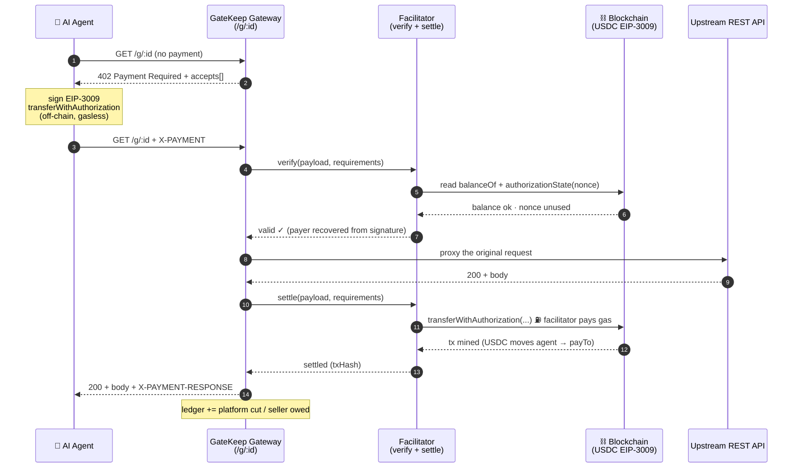
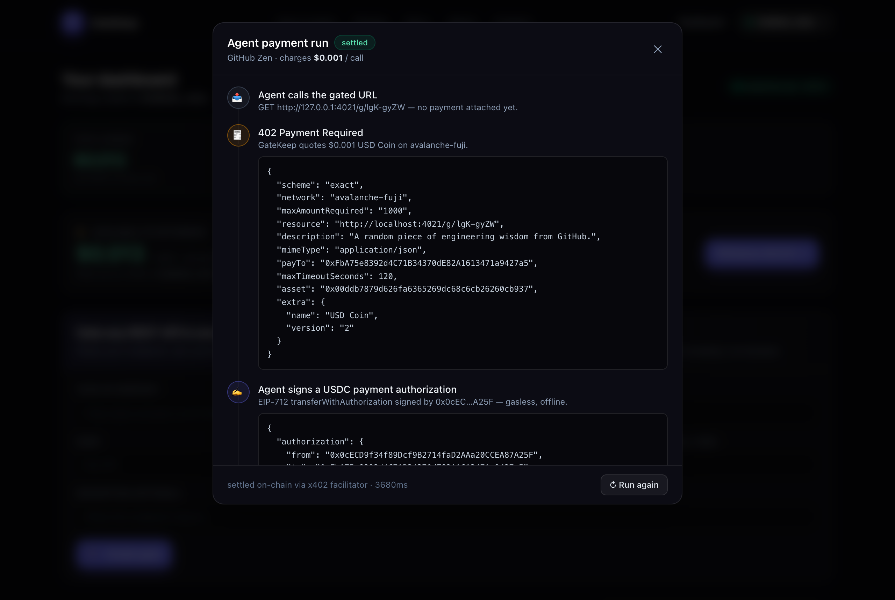
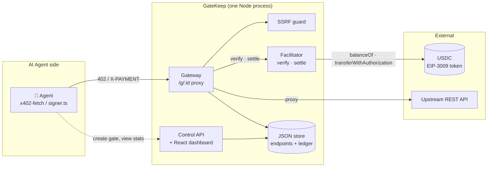
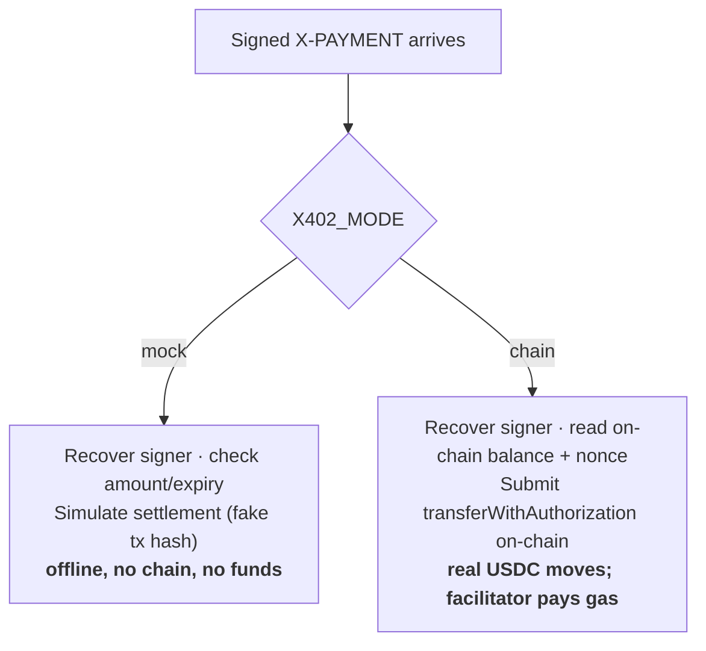
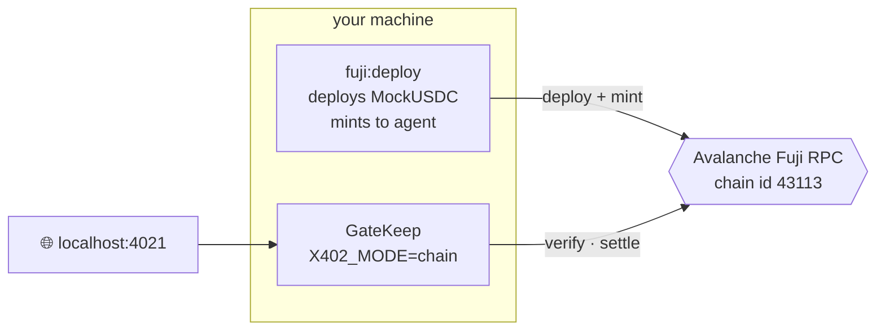
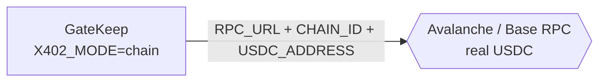
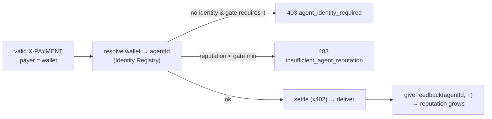

# GateKeep — Architecture & Concepts

This document explains **what GateKeep is, what the x402 protocol is, and exactly
how the whole system fits together** — from an AI agent's HTTP request down to a
USDC transfer settling on a blockchain.

If you just want to run it, see the [README](../README.md). If you want to deploy
it on Avalanche, see [DEPLOY.md](./DEPLOY.md).

---

## 1. The problem

APIs were built for humans with credit cards. You sign up, get an API key, put a
card on file, and get billed monthly.

**AI agents can't do any of that.** An autonomous agent that needs to call 50
different APIs can't fill in 50 signup forms, can't hold 50 API keys, and
certainly can't enter a credit card. What an agent *can* do is **pay, per request,
programmatically** — if only the web had a way to ask it to.

It does, sort of: HTTP has had status code **`402 Payment Required`** reserved
since 1997. It was never given a standard meaning… until x402.

---

## 2. What is x402?

**x402** is an open protocol (introduced by Coinbase) that finally gives
`402 Payment Required` a concrete, machine-payable meaning. The idea:

> When a client requests a paid resource without paying, the server replies
> **`402`** with a machine-readable description of *how much* to pay and *where*.
> The client pays by **signing a stablecoin (USDC) transfer**, attaches that
> signature to a retry of the request, and the server fulfils it.

Crucially, the payment is a **gasless, signature-based USDC transfer**
([EIP-3009](https://eips.ethereum.org/EIPS/eip-3009) `transferWithAuthorization`):

- The agent **signs** an authorization off-chain. It costs nothing and touches no
  chain.
- A **facilitator** submits that signature on-chain and **pays the gas**. The
  agent never needs native gas tokens — only USDC.

So an agent with a wallet holding USDC can pay any x402-enabled endpoint on Earth
with **zero accounts, zero API keys, zero gas, and zero human involvement.**

### The x402 wire protocol, concretely

**Step 1 — unpaid request gets a 402:**

```http
GET /g/abc123 HTTP/1.1
```
```http
HTTP/1.1 402 Payment Required
Content-Type: application/json

{
  "x402Version": 1,
  "error": "X-PAYMENT header is required",
  "accepts": [{
    "scheme": "exact",
    "network": "avalanche-fuji",
    "maxAmountRequired": "10000",            // 0.01 USDC (6 decimals)
    "resource": "https://api.example.com/g/abc123",
    "payTo": "0x3C44…93BC",                  // where the money goes
    "asset": "0x5FbD…0aa3",                  // the USDC contract
    "maxTimeoutSeconds": 120,
    "extra": { "name": "USD Coin", "version": "2" }   // EIP-712 domain
  }]
}
```

**Step 2 — the agent signs an EIP-3009 authorization** over EIP-712 typed data:

```js
TransferWithAuthorization {
  from:        agentAddress,
  to:          payTo,
  value:       10000,                 // atomic USDC
  validAfter:  0,
  validBefore: now + maxTimeoutSeconds,
  nonce:       random 32 bytes
}
```

…and base64-encodes the `{ signature, authorization }` into an **`X-PAYMENT`** header.

**Step 3 — retry with payment → resource is delivered:**

```http
GET /g/abc123 HTTP/1.1
X-PAYMENT: eyJ4NDAyVmVyc2lvbiI6MSwic2NoZW1lIjoiZXhhY3QiLCJ…

HTTP/1.1 200 OK
X-PAYMENT-RESPONSE: eyJzdWNjZXNzIjp0cnVlLCJ0cmFuc2FjdGlvbiI6IjB4…   // tx hash
Content-Type: application/json

{ "the": "actual upstream response" }
```

That's the whole protocol. GateKeep speaks it faithfully, so **any** standard
x402 client (`x402-fetch`, `x402-axios`, Coinbase AgentKit, …) can pay a GateKeep
URL with no special integration.

---

## 3. What GateKeep adds — "Stripe for AI agent API calls"

x402 is a protocol. GateKeep is the **product** that lets anyone monetize an API
with it in one click — and takes a cut, the way Stripe does for card payments.

A developer pastes any REST endpoint and a price. GateKeep:

1. Stores it and hands back a **gated URL** (`/g/:id`).
2. Runs the **402 ↔ pay ↔ proxy** dance for every agent that hits that URL.
3. **Settles** the USDC payment via its own facilitator.
4. **Splits** every payment: a configurable platform fee to *you* (the GateKeep
   operator), the rest owed to the seller. That fee is the business model.

```
   Agent pays  $0.010
              ├─ $0.001  platform fee   →  you (the GateKeep operator)
              └─ $0.009  seller earnings →  the API owner
```

---

## 4. The payment flow, end to end



Two rules make this safe and fair, both enforced in
[`gateway.ts`](../src/routes/gateway.ts):

- **Verify before serving, settle after.** The cheap off-chain checks (signature,
  recipient, amount, expiry, balance, nonce) gate access. The on-chain settlement
  happens once the upstream has produced a successful response.
- **No money for nothing.** If the upstream returns a non-2xx, the agent is **not
  charged**. If settlement fails, the resource is **withheld** and a fresh 402 is
  returned. You can never be billed for a response you didn't get.

The dashboard's **agent playground** runs this exact round-trip live and shows every
step — the 402 quote, the signed authorization, the on-chain settlement, and the
delivered response:

[](images/playground.png)

---

## 5. Component architecture



| Module | File | Responsibility |
| --- | --- | --- |
| **Gateway** | [`routes/gateway.ts`](../src/routes/gateway.ts) | The `/g/:id` proxy — the 402 dance, SSRF-guarded upstream proxy, charge-on-2xx, settlement gating |
| **Protocol** | [`x402/protocol.ts`](../src/x402/protocol.ts) | Builds `PaymentRequirements`, encodes/decodes `X-PAYMENT`, resolves the asset + EIP-712 domain |
| **Signer** | [`x402/signer.ts`](../src/x402/signer.ts) | Agent side — signs the EIP-3009 authorization |
| **Facilitator** | [`x402/facilitator.ts`](../src/x402/facilitator.ts) · [`x402/chain.ts`](../src/x402/chain.ts) | `verify` + `settle`, dispatched to mock or on-chain |
| **SSRF guard** | [`net/ssrf.ts`](../src/net/ssrf.ts) | Blocks gates pointed at loopback / link-local / private IPs |
| **Control API** | [`routes/api.ts`](../src/routes/api.ts) | Registry CRUD, stats, the live agent-playground simulator |
| **Store** | [`store.ts`](../src/store.ts) | Atomic JSON persistence of endpoints + the call ledger |
| **Dashboard** | [`web/`](../web/) | React + Tailwind UI |

---

## 6. Settlement modes

GateKeep has one switch — `X402_MODE` — that decides **how** a payment settles.
Everything else (the protocol, signing, the wire format) is identical.



| | `mock` (default) | `chain` |
| --- | --- | --- |
| EIP-712 signing | ✅ real | ✅ real |
| Signature verification | ✅ real (recovers signer) | ✅ real |
| On-chain settlement | ❌ simulated (deterministic hash) | ✅ real tx, real USDC transfer |
| Replay protection | in-memory nonce set | the token's on-chain `authorizationState` |
| Needs an RPC / funded wallet | ❌ no | ✅ yes |
| Runs offline | ✅ yes | ❌ needs a chain |
| Use it for | demos, dev, CI | **Avalanche Fuji / mainnet / any EVM** |

The key insight: **`chain` mode is RPC-agnostic.** Point it at Avalanche Fuji for
a free testnet demo, or at Avalanche / Base mainnet for production — only the env
changes.

---

## 7. Running on a real chain (Avalanche Fuji)

To show *real* on-chain settlement without spending real money, GateKeep runs in
`chain` mode against the **Avalanche Fuji** testnet, settling in a faucet-mintable
USDC ([`MockUSDC.sol`](../contracts/MockUSDC.sol)) that implements the **exact**
EIP-3009 `transferWithAuthorization` mechanism real USDC uses.



Going to mainnet (or real Circle USDC) is **only a config change** — the code path
is identical:



See [DEPLOY.md](./DEPLOY.md) for the Fuji + mainnet walk-through.

---

## 8. MockUSDC ≈ real USDC

[`MockUSDC.sol`](../contracts/MockUSDC.sol) is a ~120-line ERC-20 whose only job is
to be *protocol-identical* to Circle's USDC for the parts x402 touches:

- Same EIP-712 domain shape (`name`, `version`, `chainId`, `verifyingContract`).
- Same `TransferWithAuthorization` typehash and struct.
- Same `transferWithAuthorization(...)` and `authorizationState(...)` interface.

The only addition is an open `mint()` faucet so you can fund test agents freely.
Swap its address for real USDC and **nothing in GateKeep changes** — the
facilitator calls the same method on the same interface.

---

## 9. The revenue model

Every settled call is split and recorded in the ledger
([`revenue.ts`](../src/revenue.ts), [`store.ts`](../src/store.ts)):

- On-chain, the agent pays the full price to `payTo` (the platform wallet), which
  accumulates the gross USDC from every settlement.
- The ledger records `platformFee = price × feeRate` as **your** revenue and the
  remainder as the **seller's earnings**.
- The seller **withdraws** their accrued earnings on-chain, self-serve, from the
  dashboard: `POST /api/withdraw` calls `payoutUsdc()` ([`x402/chain.ts`](../src/x402/chain.ts)),
  which transfers their share from the platform wallet to their login wallet
  (`available = earned − already withdrawn`). The platform keeps its 10% fee.

This mirrors Stripe — the platform collects gross, holds it, and pays out the
seller's share — except every leg is a verifiable on-chain transfer. Withdrawals
require `chain` mode and a funded platform wallet (`PLATFORM_PRIVATE_KEY` + a little
AVAX for gas); without them the dashboard shows earnings but the withdraw button is
disabled. The take rate is set by `PLATFORM_FEE_BPS` (basis points; `1000` = 10%).

---

## 10. Security notes

- **SSRF.** Because operators register arbitrary upstream URLs, every proxied
  request is checked against loopback / link-local (incl. `169.254.169.254` cloud
  metadata) / private ranges, and redirects are not auto-followed
  ([`net/ssrf.ts`](../src/net/ssrf.ts)).
- **Replay.** EIP-3009 nonces are single-use — enforced on-chain by the token in
  `chain` mode, and by an in-memory set in `mock` mode.
- **No credential leakage.** `cookie`, `authorization`, and the `x-payment` header
  are stripped before proxying to the (operator-supplied) upstream.
- **Facilitator key.** In `chain` mode the facilitator wallet pays gas and submits
  settlements — treat its key like a hot wallet (see [DEPLOY.md](./DEPLOY.md)).

---

## 11. Glossary

| Term | Meaning |
| --- | --- |
| **x402** | The HTTP-402-based payment protocol agents use to pay per request. |
| **Facilitator** | The service that verifies a signed payment and submits/settles it on-chain (GateKeep runs its own). |
| **EIP-3009** | `transferWithAuthorization` — a signed, gasless token transfer. The "exact" x402 scheme. |
| **EIP-712** | The typed-data signing standard the authorization is signed with. |
| **`X-PAYMENT`** | Base64 request header carrying the signed payment payload. |
| **`X-PAYMENT-RESPONSE`** | Base64 response header carrying the settlement result (tx hash). |
| **`payTo`** | The address that receives the USDC (here, the platform wallet). |
| **atomic units** | Token amount in its smallest unit. USDC has 6 decimals, so `$0.01` = `10000`. |
| **ERC-8004** | Trustless Agents standard: on-chain identity, reputation, validation registries. |

---

## 12. ERC-8004 — identity & reputation

x402 settles the money; **ERC-8004** ("Trustless Agents") answers *who is paying*
and *whether to trust them*. GateKeep composes the two so payments are
identity- and reputation-aware.

**Registries** ([`contracts/ERC8004.sol`](../contracts/ERC8004.sol)), deployed on Fuji:

- **Identity Registry** — an ERC-721 of agent identities. `register(agentURI)` mints
  an `agentId`; `setAgentWallet(agentId, wallet)` binds the wallet the agent pays
  from (plus a `wallet → agentId` reverse index so a gateway can resolve a payer).
- **Reputation Registry** — `giveFeedback(agentId, value, …)` records attestations;
  `getSummary(agentId)` returns the count + average. GateKeep uses the **count** of
  positive attestations as the reputation signal.

**Per-gate policy** (`requireIdentity`, `minReputation` on each gate). In the
gateway, *after* the x402 payment verifies and *before* settlement:



Every successful paid call writes feedback about the agent, so an agent's on-chain
reputation **builds as it transacts** — and unlocks higher-tier gates. This is the
"payments that are also identity and reputation aware" combination the Avalanche
Agentic-Payments brief calls out. Integration lives in
[`src/erc8004/registry.ts`](../src/erc8004/registry.ts) (resolve / read reputation /
write feedback) and the policy checks in [`src/routes/gateway.ts`](../src/routes/gateway.ts).

> Simplifications for the sprint: `setAgentWallet` is owner-gated (no EIP-712
> delegation), the Validation Registry is omitted, and feedback is written by the
> platform wallet attesting successful payments. The interfaces match ERC-8004 so
> the registries are drop-in compatible.
